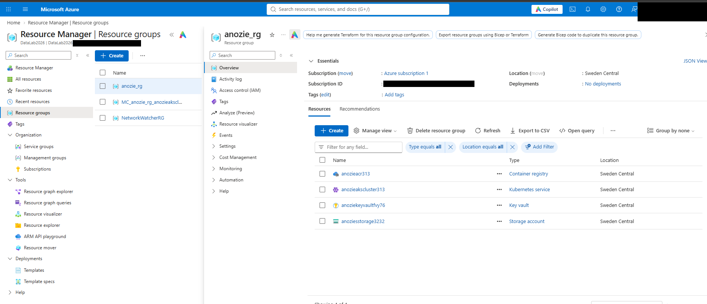
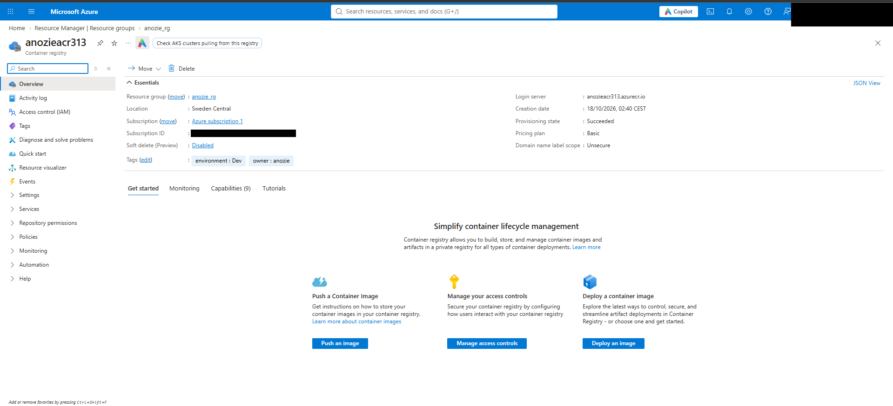
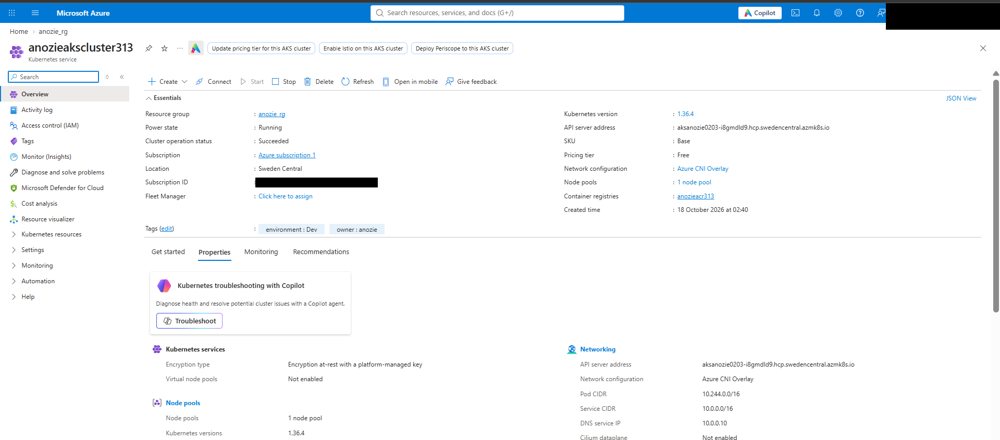
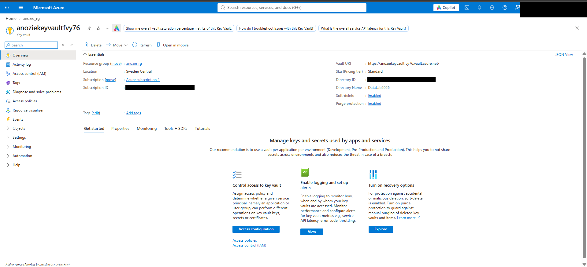
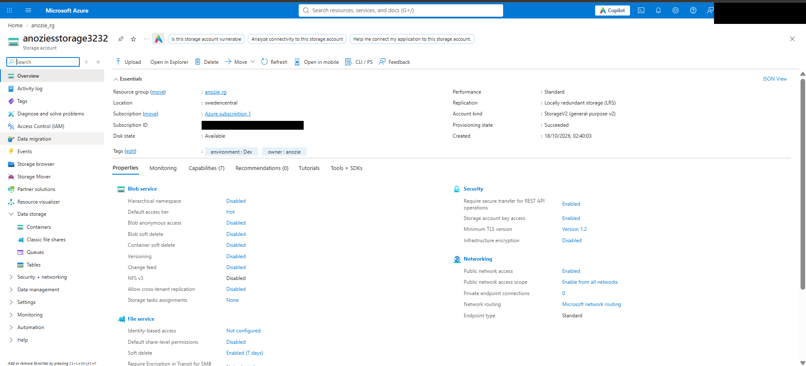
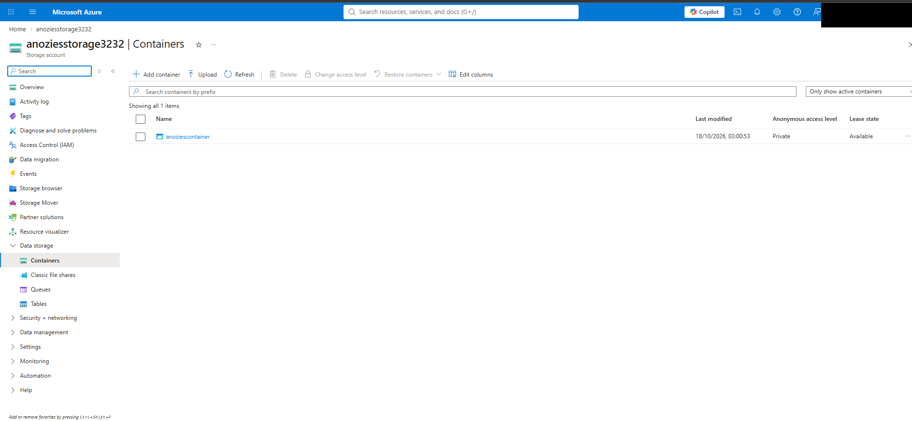
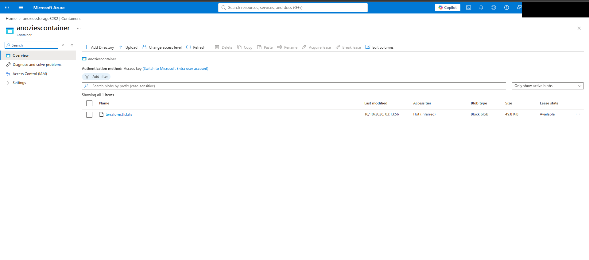
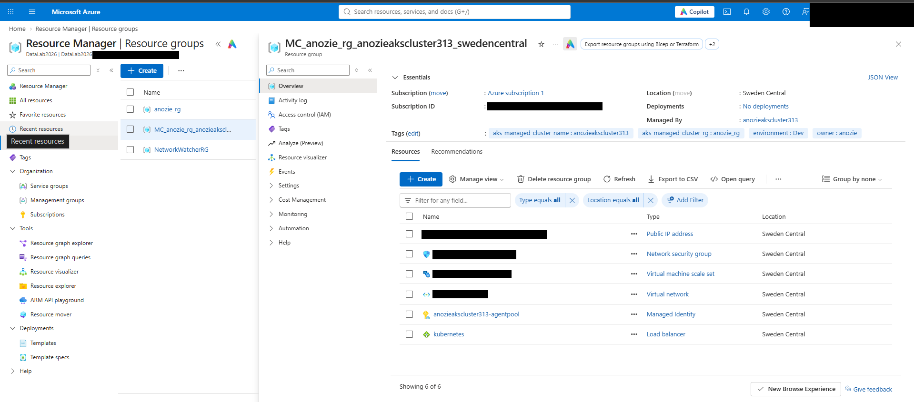

## Screenshots

Everything below was created by `terraform apply` in Azure (Sweden Central), then removed with `terraform destroy`.

### Resource group with all four resources

### Container Registry (ACR)

### Kubernetes cluster (AKS)

### Key Vault

### Storage account and blob container

### Remote state stored as a blob

### Resource group AKS created for itself

